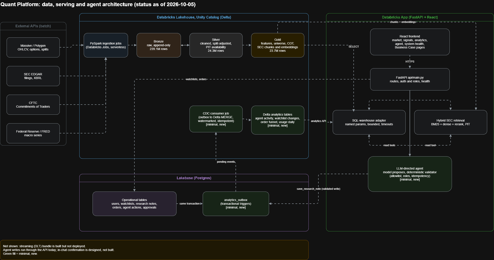

# Quant Platform — point-in-time research, retrieval and paper-trading on Databricks

A Databricks-native application for mid-frequency equity research. It ingests market, options, SEC, COT and macro data
with PySpark into a Delta medallion lakehouse, serves it through a FastAPI + React Databricks App, lets an LLM-directed
agent research a company and save a note through validated tools, and records user and agent activity in Lakebase
(Postgres) for an analytics pipeline back into Delta.

**Deployment (verified 2026-10-05; current availability not asserted here):** https://quant-platform-dev-1352785079224954.aws.databricksapps.com (Databricks workspace login required)



Diagram source (editable in diagrams.net): [`docs/proposal/architecture_drawio.drawio`](docs/proposal/architecture_drawio.drawio); the earlier Graphviz version is kept as [`architecture.png`](docs/proposal/architecture.png) / [`architecture.dot`](docs/proposal/architecture.dot). Detailed write-up:
[`docs/proposal/CAPSTONE.md`](docs/proposal/CAPSTONE.md).

---

## Capstone rubric coverage

| Requirement | How it is met | Status |
|---|---|---|
| Spark data pipeline | PySpark bronze ingestion + silver/gold transforms on Databricks serverless jobs (`notebooks/`, `pipelines/`, `silver/`, `gold/`) | Implemented; run on 2026-10-05 |
| Third-party APIs | Massive/Polygon (OHLCV, options, splits), SEC EDGAR, CFTC COT, Federal Reserve/FRED | Implemented; run on 2026-10-05 |
| Two Big Data Vs | **Volume:** 287.1M rows (239.1M bronze) · **Variety:** structured prices/options/COT/macro + unstructured SEC filing text | Measured 2026-10-05 |
| Lakebase data model | 8+ relational tables (`db/migrations/`): users, watchlists, research notes, orders, executions, positions, agent actions, approvals | Implemented |
| Action-taking AI agent | Workspace model proposes a tool call → deterministic validator (allowlist, roles, write scope, idempotency) → read tools + two write tools (`add_to_watchlist`, `save_research_note`); agent writes are authorised per request via `write_authorization`; the web chat UI does not currently send it, so in-app agent writes are not yet reachable from the chat UI (a fix is planned and not started) | Implemented; demonstrated on 2026-10-05 |
| Analytics pipeline | Lakebase transactional outbox → watermarked, idempotent Delta MERGE job → 4 analytics tables → analytics API | Implemented; run on 2026-10-05 |
| Frontend | React + Vite + Tailwind: market, signals, analytics, agent, system health | Implemented |
| Deployed application | Databricks App with SQL-warehouse data path, Lakebase resilience and health diagnostics | Deployed and verified 2026-10-05 |

Volume evidence: live `COUNT(*)` of every table at 2026-10-05 03:41 UTC in
[`docs/proposal/row_counts_2026-10-05.tsv`](docs/proposal/row_counts_2026-10-05.tsv)
(largest: `bronze_options_day` 152.1M, `bronze_ohlcv` 73.3M, `silver_ohlcv` 23.4M, `gold_ohlcv_features` 23.4M).

## Honest status

| Capability | Code | Tested | Deployed / run |
|---|---|---|---|
| Batch Spark ingestion + medallion | Yes | Yes | Run on 2026-10-05 (287M rows) |
| Split-adjusted daily prices (Massive corporate actions) | Yes | Yes | Run on 2026-10-05 |
| Commodity ETF research group (10 ETFs from `config/research_symbols.yaml` → adjusted silver + corporate actions) | Yes | Yes | Configuration only; not run against the warehouse. Research coverage — not in the 39-symbol trading universe (`config/universe.yaml`); some may still enter `gold_tradable_universe` by ADV, and this change does not add them there |
| SEC hybrid retrieval (BM25 + dense + rerank, point-in-time) | Yes | Yes | Run on 2026-10-05; as measured 2026-10-06, 230 of 558 tickers had SEC chunks (see docs/BUSINESS_CASE.md) |
| SEC knowledge graph + governed NL analytics contracts | Yes | Yes | Merged |
| SEC registrant identity from the submissions API (KG-0) | Yes | Yes (offline suite) | Not deployed or run; job `sec_submissions_ingest` is unscheduled and dry-run by default |
| SEC knowledge-graph contracts (KG-A, `sec_kg/contracts/`) | Yes | Yes (offline tests) | **Not deployed — contracts and tests only**: no Spark job, table or DDL yet (KG-C ships the builder) |
| Databricks App (FastAPI + React), warehouse data path, health/trace | Yes | Yes | **Deployed and verified 2026-10-05** — `/api/health`: Lakebase ok, SQL warehouse ok |
| Lakebase writes from the app | Yes | Yes | **Verified 2026-10-05** — app service principal has `CAN_USE` + a least-privilege Postgres role |
| LLM-directed agent (research → save note) | Yes (minimal) | Offline + live | **Live run on 2026-10-05**: `search_sec_filings(NVDA)` → `save_research_note` written to Lakebase, logged in `agent_actions` |
| Lakebase → Delta analytics (outbox CDC) | Yes (minimal) | Offline + real Postgres + live | **Live run on 2026-10-05**: outbox → `lakebase_change_events` (9) → all four analytics tables populated |
| Trading signals (`gold_trading_signals` → Signals page) | Yes | Yes | **35 baseline signals published 2026-10-05** by `scripts/publish_baseline_signals.py` (untuned logistic-regression baseline; hold-out metrics are not reported here; pipeline demonstration, no predictive edge claimed) |
| Streaming DLT pipeline | Yes | Local validation | Not deployed or run |
| Trading strategies (residual reversion, options, technical) | Partial | Yes | Research only — no profitability claim |
| IBKR paper execution | Scaffold | Partial | Not live |
| Weekend perps research (planned) | Loader, calendar and measurement tooling only (flat-file reader is design only) | Yes (offline) | Not deployed — no ingestion job, no shared tables, no signals |

Dates are the last recorded verification; this repository does not assert the current state of the app, Lakebase, or the warehouse.

## Core workflow

1. Ingestion jobs pull from the external APIs into **bronze** Delta tables (append-only, ingest timestamps).
2. **Silver** cleans, deduplicates, split-adjusts prices and stamps `information_available_ts` for point-in-time joins.
   Split-adjusted daily silver also carries the configuration-driven research group (`config/research_symbols.yaml`:
   ten commodity ETFs GLD, IAU, SLV, SIVR, USO, BNO, UNG, CPER, PPLT, PALL, plus their corporate-action splits) for
   research only; those symbols are not in the 39-symbol trading universe (`config/universe.yaml`) and never enter
   `gold_model_features` or published signals. Some may still enter `gold_tradable_universe` independently by ADV;
   this change does not add them there.
3. **Gold** builds features, the tradable universe, COT positioning and SEC chunk embeddings.
4. The **Databricks App** reads gold through a bounded, parameterised SQL-warehouse adapter and serves the React UI.
5. The **agent** retrieves SEC passages and market features (as data, never as instructions) and can save a research note
   through a validated, idempotent Lakebase write that is recorded in `agent_actions`.
6. Every Lakebase write also lands in `analytics_outbox` in the same transaction; a Delta job merges those events into
   analytics tables that the app's analytics page reads.

## Weekend perps research (planned/in progress)

Research scaffolding only: nothing is ingested on a schedule, no shared tables are written and no signal is published.
The instruments are **perpetual futures (derivatives)** traded on Hyperliquid HIP-3 and Binance USD-M, not the equities,
ETFs or spot commodities they track; they are never merged into the equity security. The owner-selected universe is
[`config/perp_universe.yaml`](config/perp_universe.yaml) (v4: 78 company perps, 8 commodity perps paired with Massive
ETFs, and BTCUSDT/ETHUSDT controls), validated by `config/perp_universe.py`; closed-market liquidity is measured while
the NYSE is shut, with the weekend window derived from [`config/market_calendar.py`](config/market_calendar.py).
History is planned from **flat files**, per the owner decision of 2026-10-22: Hyperliquid's requester-pays S3 archive
(trades in `s3://hl-mainnet-node-data/node_fills_by_block`, aggregated into our own `1m`/`15m`/`1h` trade-price bars;
`asset_ctxs` for funding/OI/mark/oracle with its field list still **to verify**; `misc_events_by_block` funding events;
optional L2 snapshots) plus Binance Vision archives for the controls. There is **no API forward-capture job**: the
Hyperliquid info API stays a probe/measurement tool. Design and schemas are in
[`docs/data/PERPS_WEEKEND_PLAN.md`](docs/data/PERPS_WEEKEND_PLAN.md), including the
`scripts/perps/hl_flat_files.py` reader design (streaming lz4, dry-run cost print before any download, `--live`
required, credentials only from the AWS profile chain) — design only, no implementation in P0.
Archive caveats are carried verbatim: uploads are **roughly monthly** with "no guarantee of timely updates and data may be
missing", and **HIP-3 (`xyz`/`para`/`io`) coverage is unverified** until a sample object is checked (owner-approved,
requester-pays). Fill records are deduplicated on the trade id (`tid`), because one trade can be emitted once per
counterparty; the P1 gate verifies that on a sample and reconciles aggregated volume against `candleSnapshot` over an
overlapping window.
Every universe row, probe/liquidity record and planned perps table carries one `data_source` provider code
(`hyperliquid`, `binance_um`, …) defined once in [`config/data_sources.py`](config/data_sources.py); the loader
rejects a missing, unknown or venue-contradicting code, and every perps table carries the derivative column set
(`instrument_type`, `underlying_type`, `underlying_symbol`, `venue`, `contract_symbol`).
The 2026-10-21 history probe measured Hyperliquid daily/funding back to each listing (NVDA from 2025-11-12); its public
output is committed as [`docs/data/perps_history_probe.json`](docs/data/perps_history_probe.json) and
`tests/perps/test_recount_weekends.py` asserts the recount in CI. That JSON is a **pre-rule snapshot**: it predates the
`data_source` rule, so it carries no `data_source` field, and its Binance rows record the pre-fix S3 listing
(`no monthly archives`), so the 2020-01/2021-12 Binance starts come from the coordinator's HTTP 200 checks, not from that
file. Its `1h` recount is an **API-only lower bound**: the public API serves at most 5,000 candles per interval, so
`1h` reaches back only to 2026-03-27 on the oldest instruments
and the window rolls forward ([`scripts/perps/recount_weekends.py`](scripts/perps/recount_weekends.py) gives 1,871
company-weekends on `1d` history but **1,538 company-weekends over 30 distinct weekends** on API-only `1h` coverage;
19 weekends / 333 company-weekends are `1d`-only). If the fills archive covers HIP-3 from listing — unverified — the
buildable panel returns to the daily-history **upper bound of ~1,871 company-weekends over 49 weekends**, still
weekend-clustered. Binance Vision archives still carry the control klines/funding from 2020-01 and metrics from 2021-12.
With 30-49 weekend clusters the effective N is the weekend count, not the row count, and the Fisher-z bound is converted
back with `tanh`: as an **illustrative single-coefficient bound** at 80% power and a two-sided 5% test, the panel can
detect partial r ≈ 0.49 (partial r² 0.24) at N_eff = 30 and r ≈ 0.39 (partial r² 0.15) at N_eff = 49, not the 0.54/0.41
the untransformed z suggested. Those numbers are **not the power of the primary test**. The **pre-registered primary
test** fixed in the plan (§6.2) is a **one-sided** test of the joint five-feature perp block over 18 weekend clusters,
using a Clark-West-adjusted loss differential and a wild-cluster-bootstrap-t; its power is **undetermined** until the
power simulation in the plan (**draft; finalised in P6**, §6.2.1: DGP estimated **only** on the 12 pinned training
weekends, from the **full-model** OLS of `open_gap` on the baseline **and** the five perp features so its residual is
orthogonal to both designs and population ΔR² = 0 is the true no-incremental-predictability null, a joint circular block
bootstrap of whole weekend-instrument rows, deterministic per-instrument alignment to each evaluation weekend's actual
instrument set, 18 evaluation weekends, the 5-feature block, one-sided 5%, 2,000 Monte Carlo replications with 999
bootstrap replications, the calibration `κ = sqrt(ΔR² · σ²_ε / ((1 − ΔR²) · q))` with `q = u'Σ_{Z|X}u` the variance of
the injected index **after residualising the perp features on the baseline design**, and reporting of the realised gains
next to their targets along with size, power curve and minimum detectable ΔR²) runs before any result is inspected. The
Clark-West ratio decides **significance only**; the effect size reported
is the **unadjusted** out-of-time ratio `mean(MSE_base − MSE_full) / mean(MSE_base)` over the 18 evaluation weekends,
with an explicit plausible set of population ΔR² in {0.005, 0.01, 0.02}. The baseline is the Friday **regular-session**
close + crypto: Friday equity extended hours (16:00-20:00 ET) and the last ES/NQ hour (to 17:00 ET Friday) trade before
`sun_1800` and are listed as confounders, and Friday-holiday weekends (2026-07-03) stay in the primary, flagged, with a
pre-declared sensitivity exclusion. The later cutoffs (`mon_0400`, `mon_0900`) stay exploratory until ES/NQ futures,
overnight ATS and pre-market bars are in their baseline.
Liquidity tiers are descriptive only (measured 2026-08-26..2026-10-21, i.e. look-ahead): any model input uses trailing
point-in-time liquidity, and the denominator counts every eligible post-listing weekend break — an empty weekend is
missing data, not full coverage. The opening-gap label uses one formula,
`open_gap = session_open * label_split_factor / prev_session_close - 1`, with the new/old split ratio as the factor;
`session_open` is the **consolidated** first regular-session print, not the listing-exchange opening auction. It is
**split-adjusted only**: `bronze_corporate_actions` has no dividend amounts, so dividend ingestion is a P1 prerequisite.

## Repository layout

| Path | Purpose |
|---|---|
| `api/` | FastAPI app (`api/main.py` is the production entry point), routes, services |
| `frontend/` | React + Vite + Tailwind SPA; `frontend/src/index.css` holds the design tokens plus the page-level horizontal-overflow guard, and `frontend/src/components/Eyebrow.tsx` the shared italic-serif section label used on every screen |
| `agent/` | Agent runtime, tool contracts, retrieval and write tools, guardrails |
| `db/` | SQL-warehouse adapter, Lakebase client, schema contract, Postgres migrations |
| `notebooks/`, `pipelines/`, `silver/`, `gold/` | Ingestion jobs and medallion transforms |
| `config/` | Universe and research-symbol YAML with their loaders, and the shared `data_source` vocabulary (`config/data_sources.py`); every research-symbol row names its provider from that vocabulary |
| `sec_kg/contracts/` | KG-A executable contracts (identity and ids, bitemporal events, fact linking, join/edge registry, publication CAS, perp Instruments); pure Python with offline tests — no table or job yet |
| `resources/`, `databricks.yml`, `app.yaml` | Databricks Asset Bundle: jobs, app, resources |
| `strategies/`, `ml/` | Research code (backtests, evidence, models) |
| `config/`, `scripts/perps/` | Perp universe/calendar config; probe, closed-market liquidity measurement and the flat-file reader design (research scaffolding) |
| `evals/` | RAG evaluation harness |
| `config/` | Environment settings, ticker/universe YAML, and the `data_source` provider vocabulary (`config/data_sources.py`) |
| `tests/` | Offline test suite |
| `docs/` | Deployment, runbooks, data schemas, proposal |

The inherited Rag_workbench RAG/DuckDB stack (LangGraph orchestration, DuckDB-backed chat/SQL services and review
schemas) was deleted because no app or job entry point started it. A dead-code guard now fails the suite if an
`api.*` module becomes unreachable: `scripts/check_api_reachability.py` derives the reachable set from `api.main`,
the executable packages and `resources/*.yml` job tasks, and `tests/test_no_dead_api_modules.py` asserts it.
The guard ignores comments and docstrings, so prose about a retired module cannot keep it alive, and it has two
known limits: every module in an executable package counts as a live root (lenient — an `api.*` module used only by
a retired pipeline still passes), and computed dynamic imports (`importlib.import_module(f"api.{name}")`) are
invisible to the scan.

## Local development

Python dependencies are managed with [uv](https://docs.astral.sh/uv/).
`pyproject.toml` + `uv.lock` are the source of truth; the committed
`requirements.txt` is a generated export (never edit it by hand).

```bash
uv sync --frozen --group dev      # installs runtime + dev/test tooling (Python 3.12)
uv run pytest -q -m "not spark and not lakebase and not databricks"   # offline suite
cd frontend && npm ci && npm test -- --run && npm run build
uv run uvicorn api.main:app --reload
```

After changing dependencies in `pyproject.toml`, run `uv lock`, then
`./scripts/export_requirements.sh` to refresh the committed runtime export.
CI fails when either the lock or the export is stale. See
[`docs/CICD.md`](docs/CICD.md#dependency-workflow-uv) for the full workflow
(including why `ibapi` is installed manually and never locked).

The frontend follows the owner's site (evangoh.com) palette, italic-serif
eyebrows, 16 px cards and a centred 1200 px content column, and it is
deliberately dark-only — that brand match is the documented trade-off against
HIG `dark-mode.md`. One brand mark is shown per view: the top-bar `Q` monogram,
with the sidebar and the mobile drawer kept navigation-only, and each eyebrow
names its section's category instead of repeating the title
(`frontend/src/layout/brand-and-eyebrows.test.tsx` guards both). Text never
renders below 12 px (13 px `text-xs` captions), including inside the scaled SVG
price chart and architecture diagram: each declares a minimum render width equal
to its viewBox width, so a 12-unit label is never smaller than 12 CSS px and
narrow viewports scroll inside the chart or diagram card instead.
`frontend/src/layout/layout-overflow.test.tsx` asserts the shell, column,
wrapping and type-size guards on all 18 destinations at the four widths it
covers — 320, 375, 390 and 768 px — and re-derives the rendered type floor from
the populated chart and diagram. Those are automated DOM/source assertions, not
a browser pass; a manual browser check across those widths is still owed.

Configuration comes from environment variables / bundle variables (`CATALOG`, `SCHEMA`, `DATABRICKS_WAREHOUSE_ID`,
`LAKEBASE_INSTANCE`, `AGENT_MODEL_ENDPOINT`); no credentials are committed. Secrets live in a Databricks secret scope.

## Databricks deployment

```bash
databricks bundle validate -t dev
databricks bundle deploy -t dev    # builds frontend/dist + requirements.txt via bundle artifacts
# Then Deploy the app in Databricks Apps; grant the app service principal Lakebase access (docs/DEPLOYMENT.md)
python scripts/smoke_app.py --base-url <app-url>
```

## Public demo (Hugging Face Space)

The public showcase runs as a Docker Space built from
[`deploy/hf/Dockerfile`](deploy/hf/Dockerfile) in read-only demo mode. Publish
notes (and the `<HF_NAMESPACE>/<HF_SPACE>` placeholder) are in
[`docs/HF_SPACE_DEPLOY.md`](docs/HF_SPACE_DEPLOY.md); `scripts/publish_hf_space.sh`
is dry-run by default and requires `--yes` to upload. Render is retired.

## Engineering process

Changes are implemented by the scheduled coder — MiMo or DeepSeek, selected by UTC peak hours — and independently
validated by the other model, then gated by exactly one final reviewer: Codex Sol for every change, with Claude
Opus 5.5 only as a recorded fallback when Sol cannot run because of a token limit, usage limit, rate limit, or quota limit, followed by CodeRabbit review
(see root `AGENTS.md` for the full chain).
Every PR also updates this README (or states in the PR why no change is needed) and, when it changes tables, terms, joins
or knowledge-graph node/edge types, its slice of `ontology/` in the same commit (see root `AGENTS.md`).
Security: dependency audit (`pip-audit`, `npm audit`) and secret scanning run in CI —
see [`docs/SECURITY.md`](docs/SECURITY.md).

## Known limitations

- SEC retrieval supports per-ticker queries via lazy loading with SQL-warehouse fallback for Databricks Apps, but corpus coverage is incomplete (230 of 558 tickers had chunks as measured 2026-10-06; see docs/BUSINESS_CASE.md).
- SEC registrant identity (KG-0, added 2026-10-22): `pipelines/ingest_sec_submissions.py` fetches `data.sec.gov/submissions` into `bronze_sec_submissions`, and `silver/09_silver_sec_registrant.sql` derives `silver_sec_registrant` (one row per distinct payload — filter `is_latest` for the current name, SIC and tickers/exchanges as observed at fetch time) and `silver_sec_registrant_former_names` (inclusive former-name intervals keyed by name and start date). The `sec_submissions_ingest` job is unscheduled and dry-run by default; a live run needs owner approval. The public availability time of a submissions document is unknown here, so these tables are not used for point-in-time joins. `bronze_sec_filings_v2.company_name` holds the canonical ticker, not a company name (`pipelines/sec_rag_ingest.py:1637`), so company names must come from the registrant tables. Every row in these three tables carries `data_source = 'sec_edgar'` from `config/data_sources.py`.
- The agent and analytics pipeline are minimal versions built for the capstone deadline. The analytics job is run on demand (it needs a short-lived `LAKEBASE_URL` at run time).
- Macro (Fed) series are revised values, not first-release vintages.
- Price adjustment is split-only: distributions/dividends are not adjusted, so an ETF ex-distribution gap stays in
  returns. This matters for the commodity ETF research group (`config/research_symbols.yaml`).
- `return_1d` in `silver_ohlcv_day_adjusted` is close-to-close on adjusted prices (`adj_close` / `LAG(adj_close)` - 1);
  `raw_overnight_return` is close-to-close on **unadjusted** prices (`close` / `LAG(close)` - 1), so splits jump it
  (a 1-for-4 reverse split shows about +300% raw against 0% adjusted). Neither is the opening-gap label; the gap label
  is next-session `adj_open` / previous-session `adj_close` - 1.
- Futures-backed commodity ETFs (USO, BNO, UNG, CPER) carry roll yield, so contango/backwardation price moves are not
  spot commodity moves; physical ETFs (GLD, IAU, SLV, SIVR, PPLT, PALL) do not.
- Strategy research reports are descriptive; several are marked `BLOCKED_DATA` (fewer than two complete out-of-sample years).
- The streaming DLT pipeline is built but not deployed.
- Published signals come from an untuned logistic-regression baseline; hold-out metrics are not reported here; they demonstrate the features → model → `gold_trading_signals` → app path, not a trading edge. All directions UP.
