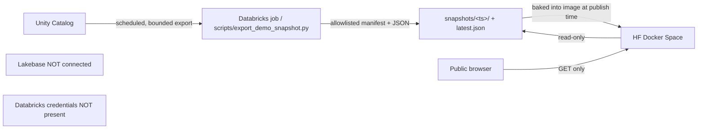

# Hugging Face Space deployment plan (public, read-only showcase)

Status: **planned; not deployed.** Nothing in this document authorizes a
publish. Publishing is a manual, owner-only step (see "Publishing" below).
Render is **retired**: `render.yaml`, `requirements-render.txt`, the Render CI
audit step and `tests/render/` no longer exist.

The Space id has not been decided. It is written as the placeholder
`<HF_NAMESPACE>/<HF_SPACE>` in this document and in exactly one constant in
`scripts/publish_hf_space.sh`. Do not invent a namespace or space name.

## Why snapshot-first (unchanged rationale)

The public showcase must stay useful when Lakebase, the SQL warehouse, the app
service principal or an LLM is unavailable — and it must never hold a
credential. So:

1. The public experience is served from a **pre-reviewed, versioned snapshot
   bundle**, not from live Unity Catalog reads.
2. The API runs in public-demo mode (`PUBLIC_DEMO=1`), read-only, with no
   Lakebase client, no broker client and no identity trust.
3. Live Databricks reads and live RAG remain out of scope for the public demo.
   They are a later, explicitly budgeted feature behind a flag.

The container is a single FastAPI process that serves both `/api/*` and the
built SPA, so there is no cross-origin configuration and no second service to
keep in sync.



## Image

`deploy/hf/Dockerfile` is the recipe. It is kept under `deploy/hf/` because the
repository root is the Databricks bundle sync root and a root `Dockerfile`
would be picked up by unrelated tooling; the publish script copies it to
`Dockerfile` in the staged Space tree, which is the only path the Hub's Docker
builder reads.

* Stage 1 (`node:20.18.0-slim`) builds the SPA: `npm ci && npm run build`, with
  `VITE_POSTHOG_KEY` / `VITE_POSTHOG_HOST` build ARGs carrying the public
  PostHog values (unset -> analytics disabled).
* Stage 2 (`python:3.12-slim`) copies a version-pinned `uv` binary, runs
  `uv sync --frozen --no-dev` from `uv.lock`, copies only the runtime packages
  (`api/`, `agent/`, `db/`, `config/`, `security/`, `pipelines/`, `sec_kg/`,
  `data/sentiment_dict/`) and `frontend/dist`.
* Runs as non-root uid 1000 (HF requirement), exposes 7860, sets
  `PUBLIC_DEMO=1` / `APP_ENV=demo`, and declares a `HEALTHCHECK` on
  `/api/health`.

`.dockerignore` excludes `.git`, `.agents`, `.agentlogs`, `.venv`, caches,
tests, local data, `node_modules` and every secret-shaped file (`.env*`,
`*.pem`, `*.key`, `.databrickscfg`, `auth.json`, `secrets.json`).

## Space README

HF requires YAML front matter in the Space repository's `README.md`. The project
README must stay the project README, so the Space README is generated from
`deploy/hf/README.space.md`:

```yaml
---
title: Quant Platform — public demo
emoji: 📈
colorFrom: indigo
colorTo: gray
sdk: docker
app_port: 7860
pinned: false
short_description: Read-only quant research demo — snapshots, no credentials
---
```

## Environment and the fail-closed gate

HF injects these at runtime (verified against
<https://huggingface.co/docs/hub/en/spaces-overview#built-in-environment-variables>):
`SPACE_ID`, `SPACE_HOST`, `SPACE_AUTHOR_NAME`, `SPACE_REPO_NAME`, `SPACE_TITLE`,
`SPACE_CREATOR_USER_ID`, `SPACE_SIGNING_SECRET`, `CPU_CORES`, `MEMORY`,
`ACCELERATOR`; plus `HF_HOME` (see
<https://huggingface.co/docs/hub/en/spaces-config-reference>).

On Render the public-demo gate keyed on `RENDER`. A Space never sets `RENDER`,
so that gate is now generalized in `api/demo.py`:

* `is_hosted_public()` is true when `RENDER` **or** `SPACE_ID` is set.
* `validate_hosted_public_environment()` refuses to start with write routes
  when a hosted public marker is set and `PUBLIC_DEMO` is not enabled.
* `validate_public_demo_environment()` rejects every credential family
  (`LAKEBASE_*`, `DATABRICKS_*`, broker vars, `*_TOKEN`, `HF_TOKEN`, ...).
* The HF-injected non-secret variables are allow-listed so the Space can boot.
  `SPACE_SIGNING_SECRET` is allowed deliberately: it is a Space-local signing
  key with no access to Lakebase, Databricks or a broker, and this app never
  reads it. `HF_TOKEN`/`APP_DATA_HF_TOKEN` remain rejected.

Never configure secrets in the Space: no `LAKEBASE_*`, no `DATABRICKS_*`, no
broker tokens, no `HF_TOKEN`, no `VITE_*` value containing a token.

## Snapshot bundle (still true, next step)

The snapshot layer is specified in `BUILD-demo-snapshot.md`. Where it still
applies to the HF design:

* The producer writes a complete bundle to a new versioned prefix, validates
  it, then atomically publishes `latest.json`; the previous bundle is retained.
* Contents are an allowlist, never a dump: `manifest.json` (schema version,
  `generated_at`, per-file sha256, row counts, per-table max source timestamp)
  plus bounded JSON per snapshot key. Never user, order, approval, account,
  position, note, prompt, audit payload or unrestricted filing text.
* Vendor market data (`--include-vendor-market-data`) stays **OFF**: the Space
  is public and OHLCV/options are licensed. With the flag off, market endpoints
  serve derived, non-redistributable fields only or report "unavailable:
  licensing".
* Snapshots are baked into the image at publish time (never fetched with a
  token at runtime). `snapshots/` is gitignored and the publish script will copy
  it into the staged tree.

Until that lands, the demo serves "unavailable" panels; the image still starts
and `/api/health` responds.

## Publishing (owner only)

```bash
git fetch origin main
./scripts/publish_hf_space.sh                 # default: dry run
./scripts/publish_hf_space.sh --yes           # uploads to <HF_NAMESPACE>/<HF_SPACE>
python scripts/smoke_app.py --base-url https://<space-subdomain>.hf.space
```

The script:

1. refuses a dirty worktree and a `HEAD` that is not `origin/main` (a
   `--dry-run --ref <ref>` override exists for staging previews only);
2. stages `git archive` of tracked files into a temp dir outside the repo;
3. swaps in the Space README and the Dockerfile;
4. fails if any secret-shaped file or token material is in the staged tree and
   prints the staged file list;
5. uploads with `hf upload` (Hub CLI reads `HF_TOKEN` from the environment or
   uses `hf auth login`; the token is never an argument, never printed, never
   written to disk).

It defaults to a dry run and requires an explicit `--yes`.

## Smoke tests

```bash
curl -s https://<space-subdomain>.hf.space/api/health
curl -s -o /dev/null -w '%{http_code}\n' https://<space-subdomain>.hf.space/
curl -s -o /dev/null -w '%{http_code}\n' https://<space-subdomain>.hf.space/results/walk-forward
```

Expected: 200 for all three; the deep link must return the SPA shell, not 404
(the FastAPI static fallback serves `index.html` for non-`/api/*` paths).

## Rollback

Re-publish from the last known-good `origin/main` commit (the Space rebuilds on
push). No automatic rollback is configured.

## Safety gates

Before the URL is shared publicly, the Lane B and Lane C gates must be complete:

* **Lane B** (R2, R3, R4, R7; PR #21): demo-mode access control, write-surface
  removal, startup secret checks, abuse controls.
* **Lane C** (R5, R6): snapshot reader validation and export tooling.

Without them the service would expose write endpoints and trust spoofed
identity headers.
